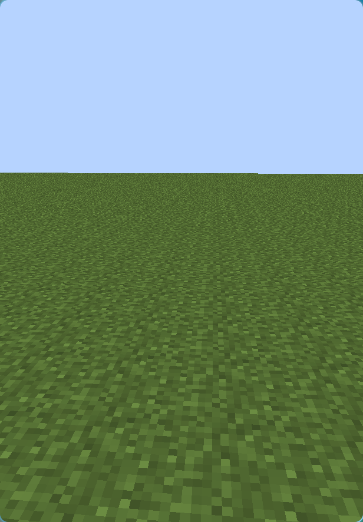

# ninefold

Minecraft: Java Edition **1.8.9**, rewritten in Rust.

> Not an official Minecraft product, and not approved by or associated with Mojang or Microsoft.
> ninefold contains no Minecraft code, assets or data — you need your own copy of the game.

## Credit where it's owed

The idea, and most of the groundwork, is **[Horizon](https://playhorizon.dev)**
([horizon-rust/horizon](https://github.com/horizon-rust/horizon)) — they rewrote Minecraft Java
Edition **26.3** in Rust and proved the whole thing was possible: a million lines, 300+
differential harnesses against the Java game, full vanilla parity. ninefold exists because they
showed the way, and it reuses their MIT-licensed foundations where they carry over.

ninefold is not a Horizon release and is not affiliated with them. Bugs here are ours.

**What ports across:** rendering (wgpu), windowing, asset plumbing.

**What cannot:** the data model, which is the hard part. 1.8.9 is *pre-flattening*. Blocks are an
ID plus four bits of metadata, not block states; chunks arrive as fixed arrays, not palettes;
items carry damage values as subtypes; combat has no attack cooldown — which is the entire reason
anyone still plays 1.8.9. None of that survives contact with a 1.13+ architecture.

## Why 1.8.9

Because that is where the players are. 1.8 PvP is a living scene, and the 1.9 combat update is
exactly what it refuses. A modern client with a translation proxy ships the thing that audience
rejects, so the mechanics have to be native.

## Scope

Full parity, singleplayer included — worldgen, mob AI, redstone, loot, the lot. This is a
multi-year target, built in order of what can be proved:

| Phase | | State |
|---|---|---|
| 1 | Protocol 47: codec, handshake, status, login | **done** |
| 2 | Headless join: chunks decoded, 1.8 movement prediction, walk a real server | **done** |
| 3 | Rendering: terrain meshing, entities, HUD | **in progress** — textured terrain; entities and HUD next |
| 4 | Singleplayer: world storage, worldgen, mob AI, redstone | |

Phase 2 is the one that decides whether the rest is worth building. It needs no renderer, and a
tick trace either feels like 1.8 or it doesn't.

## Testing against a real server

Outbound 25565 is often filtered, and public servers rate-limit, so the honest test target is a
local one: Mojang's own 1.8.9 server jar, `online-mode=false`, on a spare port. `ninefold join`
then logs in, waits for the world and walks a few blocks:

```
logged in as ninefold (5d45374d-1452-3612-a52a-de8215caa576)
  compression above 256 bytes
joined: entity 0, gamemode 0, dimension 0, flat world, 5 player slots
placed at x=1015.50 y=4.00 z=590.50
walked 5.00 blocks east, still connected
```

The chunk decoder is checked against the one world whose contents are known in advance — a
flat world is bedrock, dirt, dirt, grass, and that is what comes out:

```
the column at x=1025 z=590:
  y=3  grass
  y=2  dirt
  y=1  dirt
  y=0  bedrock
```

The server agrees, which is the part that counts:

```
ninefold[/127.0.0.1:36038] logged in with entity id 0 at (1015.5, 4.0, 590.5)
ninefold joined the game
```

## The movement

The 1.8 feel is the reason this targets 1.8.9 at all, so the constants are checked against the
numbers the game is known for rather than against anything the code decided:

| | |
|---|---|
| walking | 4.317 blocks/second |
| sprinting | 5.612 blocks/second |
| jump apex | 1.2522 blocks |
| terminal fall | 3.92 blocks/tick |

The order inside a tick matters as much as the constants: friction applies to the motion carried
in from last tick *before* this tick's input is added, and gravity applies *after* the position
has moved. Swap either and the numbers above come out wrong.

Diagonal movement is about 2% faster, and that is correct — `moveFlying` only scales input down
when its magnitude is over 1, so a straight line keeps the 0.98 a held key gives while a diagonal
(1.386) is normalised to 1.0. The same 0.98 is what puts walking at 4.317, so "fixing" one breaks
the other.

Driven against a real server, the physics is accepted without a single correction:

```
sprinted 16.50 blocks in 3.0s = 5.500 blocks/second
  speed now 5.612 b/s, on ground true
  the server accepted every step
```



*A vanilla 1.8.9 server's world, decoded, meshed and drawn with the player's own textures.*

## Running it

```sh
cargo run --release -p ninefold-cli    -- ping 127.0.0.1:25599        # what is this server
cargo run --release -p ninefold-cli    -- join 127.0.0.1:25599 name   # headless: join, decode, walk
cargo run --release -p ninefold-client -- 127.0.0.1:25599 name        # with a window
```

In the window: WASD to move, space to jump, left control to sprint, left shift to sneak, click to
take the mouse for looking, escape to give it back.

The physics runs on its own 20 Hz clock rather than per frame, the way Minecraft's own loop does,
so movement is identical at 30 frames a second or 300.

## The atlas

A draw call samples one texture, so every block face comes out of a single image of 16×16 tiles.
Two of them are not simply copied in:

- **grass_top** ships greyscale and is tinted by biome at draw time. Untinted, the whole world is
  grey — which reads as a renderer bug and is not one.
- **grass_side** is pre-coloured dirt with a separate cut-out, `grass_side_overlay`, carrying the
  green. They are composited with the overlay tinted, which is where a grass block's green edge
  comes from.

Sampling is nearest-neighbour, because 1.8's textures are 16 pixels across and are meant to look
it, and the fragment shader cuts out below half alpha rather than blending, so leaves and glass
work without sorting anything back to front.

## Where the artwork comes from

ninefold ships no Minecraft assets and never will: the engine can be rewritten, the artwork
cannot be redistributed. Nothing in the client opens a jar directly — it asks for
`blocks/grass_top`, and an [`AssetSource`](crates/ninefold-assets) decides where that comes from:

- your own copy of the game, read in place and nothing copied out of it, or
- ninefold's own placeholder art, so the client still runs for someone who has no copy.

That is the whole plug-and-play story. Installed, you get the game's look; not installed, you
still get a game. Only the first needs you to own Minecraft, and the client never has to be
started through the Java launcher — downloading a version is enough.

## Mods

Java mods will never work here. Forge, Fabric, OptiFine and anything else that loads into the JVM
has no JVM to load into. That is a consequence of the rewrite, not a gap to be filled later.

## Build

```sh
cargo test        # the protocol codec is checked against the protocol's own reference values
cargo clippy --all-targets
```

## Licence

MIT, matching Horizon.
